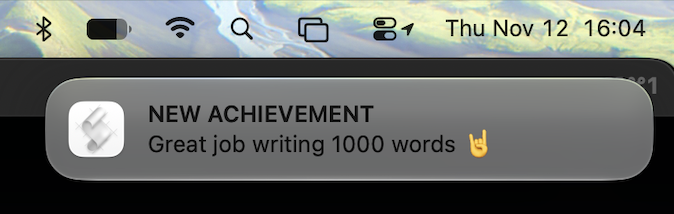

# small-victories

Watches the top-level files in a directory for word count changes and sends a MacOS notification celebrating reaching a word count goal for a day.

Run with `task run`, install globally to mac with `task install-bg-mac`, and watch the global logging with `task tail-bg-mac`.